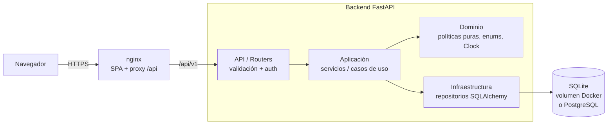

# Sistema de Biblioteca

Sistema full-stack para gestionar una biblioteca: catálogo con ejemplares físicos, socios con carnet, préstamos con límites por tipo de socio, devoluciones, renovaciones, **reservas con cola FIFO**, **multas por retraso con bloqueo por deuda** y reportes de circulación y morosidad.

Construido con **FastAPI + SQLAlchemy 2 + Pydantic v2** en el backend y **React 18 + Vite + TypeScript + Tailwind CSS** en el frontend. Es un proyecto de portafolio pensado para leerse: el código explica el *por qué* de cada regla de negocio y la carpeta [`docs/`](docs/) documenta la arquitectura y las decisiones.


---

## Tabla de contenidos

- [Características](#características)
- [Arquitectura](#arquitectura)
- [Stack y justificación](#stack-y-justificación)
- [Inicio rápido con Docker](#inicio-rápido-con-docker)
- [Inicio sin Docker](#inicio-sin-docker)
- [Credenciales demo](#credenciales-demo)
- [Reglas de negocio](#reglas-de-negocio)
- [Endpoints principales](#endpoints-principales)
- [Pruebas](#pruebas)
- [Estructura de carpetas](#estructura-de-carpetas)
- [Variables de entorno](#variables-de-entorno)
- [Cambiar a PostgreSQL](#cambiar-a-postgresql)
- [Qué aprenderás con este proyecto](#qué-aprenderás-con-este-proyecto)
- [Roadmap](#roadmap)
- [Licencia y autor](#licencia-y-autor)

---

## Características

**Catálogo**
- Libros (ISBN-10/13 validado con dígito de control), autores, categorías.
- Ejemplares físicos con **código de inventario** único y estado: `disponible`, `prestado`, `apartado`, `mantenimiento`, `perdido`.
- Búsqueda por título, ISBN o autor; filtros por categoría y disponibilidad; orden y paginación.

**Circulación**
- Préstamo por **carnet del socio + código de inventario** (pensado para lector de código de barras).
- Límites por tipo de socio: estudiante, docente y externo con días y máximos distintos.
- Devoluciones con **multa automática por día de retraso**.
- Renovaciones con límite por tipo de socio y **bloqueadas si hay reservas pendientes**.
- **Reservas con cola FIFO**: al devolverse un ejemplar queda *apartado* para el primero de la cola durante N días; si no lo recoge, pasa al siguiente.
- **Bloqueo por deuda** con umbral configurable y por préstamos vencidos.

**Seguridad y roles**
- JWT (PyJWT) + contraseñas con bcrypt.
- Roles `admin`, `bibliotecario`, `socio`. El socio **solo ve y gestiona lo suyo** (préstamos, reservas, multas), forzado en el backend.

**Reportes**
- KPIs del dashboard, libros más prestados (con rango de fechas) y morosidad.

**Calidad**
- Arquitectura en capas, inyección de dependencias, errores **ProblemDetails (RFC 7807)**, logging JSON con `X-Request-ID`, `/health`.
- **Reloj inyectable** (`Clock`) para probar fechas sin esperar días reales.
- 63 pruebas backend (unitarias + integración) y 24 pruebas frontend. CI en GitHub Actions.
- UI responsive con sidebar, modo oscuro y estados de carga/vacío/error.

## Arquitectura



Cada petición atraviesa: **router** (valida DTO y rol) → **servicio** (aplica reglas y controla la transacción) → **repositorio** (consultas) → base de datos. Las reglas puras (límites, multas, renovaciones, bloqueo) viven en `app/domain/policies.py` sin dependencias de BD ni HTTP. Detalle en [`docs/arquitectura.md`](docs/arquitectura.md).

## Stack y justificación

| Capa | Tecnología | Por qué |
|---|---|---|
| API | **FastAPI** | Tipado, validación con Pydantic y OpenAPI/Swagger automáticos; `Depends` da inyección de dependencias nativa. |
| ORM | **SQLAlchemy 2** | API tipada (`Mapped[...]`), portable entre SQLite y PostgreSQL. |
| DTOs | **Pydantic v2** | Validación rápida y declarativa; mensajes de error por campo. |
| Auth | **PyJWT + bcrypt** | Bibliotecas mínimas y mantenidas (passlib está abandonada y falla con Python 3.13+). |
| BD | **SQLite** | Cero instalación para demo y pruebas en memoria; un cambio de `DATABASE_URL` lleva a PostgreSQL. |
| Frontend | **React 18 + Vite + TS** | Ecosistema estándar, build rápido, tipado end-to-end con los DTOs. |
| Estilos | **Tailwind CSS 3** | Diseño consistente y modo oscuro con `dark:` sin CSS a medida. |
| Pruebas | **pytest, Vitest, Testing Library** | Rápidas, sin Docker; pruebas centradas en comportamiento. |
| Entrega | **Docker multi-stage + nginx** | Imágenes pequeñas, usuario no root, proxy `/api` sin CORS. |

## Inicio rápido con Docker

Requisitos: Docker con Compose v2.

```bash
docker compose up --build
```

- Aplicación: <http://localhost:8080>
- API + Swagger: <http://localhost:8000/docs>

La base SQLite se guarda en el volumen `biblioteca-data` y se carga con datos de demostración la primera vez (`SEED_ON_STARTUP=true`). Para empezar de cero: `docker compose down -v`.

## Inicio sin Docker

### Backend (Python 3.12+)

```bash
cd backend
python -m venv .venv
# Windows: .venv\Scripts\activate    ·   Linux/macOS: source .venv/bin/activate
pip install -r requirements-dev.txt
python -m app.seed                       # crea biblioteca.db con datos demo
uvicorn app.main:create_app --factory --reload
```

API en <http://localhost:8000>, documentación interactiva en <http://localhost:8000/docs>.

### Frontend (Node 24)

```bash
cd frontend
npm ci
npm run dev
```

Abra <http://localhost:5173>. Vite redirige `/api` a `http://localhost:8000` (configurable con `VITE_API_PROXY`).

## Credenciales demo

Todos los datos son **ficticios** (nombres, DNI, correos e ISBN con prefijo 978-612 generados).

| Rol | Correo | Contraseña |
|---|---|---|
| Administrador | `admin@demo.pe` | `Demo123!` |
| Bibliotecario | `bibliotecario@demo.pe` | `Demo123!` |
| Socio (estudiante) | `socio@demo.pe` | `Demo123!` |

El seed **simula 45 días de operación** usando los mismos servicios de la API, así que los datos son coherentes: hay préstamos vencidos, multas pagadas y pendientes, un socio bloqueado por deuda, una reserva que expiró y pasó al siguiente de la cola, y una reserva pendiente del socio demo.

## Reglas de negocio

| Tipo de socio | Préstamos simultáneos | Días | Renovaciones |
|---|---|---|---|
| Estudiante | 3 | 14 | 2 |
| Docente | 10 | 30 | 3 |
| Externo | 2 | 7 | 1 |

- **Multa** = días de retraso × `FINE_PER_DAY` (S/ 1.00 por defecto). Devolver el día del vencimiento no genera multa. Se guarda en céntimos para evitar errores de redondeo.
- **Bloqueo**: no puede prestar ni reservar quien tenga deuda pendiente ≥ `DEBT_BLOCK_THRESHOLD` (S/ 10.00), y no puede prestar quien tenga préstamos vencidos. Pagar la multa desbloquea al instante.
- **Renovación**: extiende desde el vencimiento actual; se rechaza si el préstamo está vencido, si se alcanzó el máximo o si hay socios en cola para ese libro.
- **Reserva**: solo si no hay ejemplares disponibles; una por socio y libro. Al volver a circular un ejemplar (devolución, alta, fin de mantenimiento, cancelación o expiración) se aparta para el primero de la cola por `RESERVATION_HOLD_DAYS`. Un ejemplar apartado solo se presta al socio que lo reservó.
- Un socio no puede tener dos ejemplares del mismo título a la vez.

## Endpoints principales

Prefijo: `/api/v1`. Documentación completa en `/docs` y ejemplos `curl` en [`docs/guia-api.md`](docs/guia-api.md).

| Método | Ruta | Rol | Descripción |
|---|---|---|---|
| POST | `/auth/login` | público | Obtener JWT |
| GET | `/auth/me` | autenticado | Usuario actual |
| GET/POST | `/users` | admin | Listar / crear usuarios |
| GET/POST | `/members` | personal | Listar (búsqueda, filtro, orden) / registrar socio |
| GET | `/members/{id}/status` | personal o el propio socio | Límites, deuda y bloqueos |
| GET | `/members/me/status` | socio | Mi situación |
| GET | `/books` | autenticado | Catálogo con `q`, `category_id`, `author_id`, `available`, `sort`, `page`, `size` |
| POST | `/books` | personal | Registrar libro (con ejemplares iniciales) |
| GET/PATCH | `/books/{id}` | autenticado / personal | Detalle con ejemplares / actualizar |
| POST | `/books/{id}/copies` | personal | Agregar ejemplar |
| PATCH | `/copies/{id}/status` | personal | Disponible / mantenimiento / perdido |
| GET/POST | `/authors`, `/categories` | autenticado / personal | Catálogos auxiliares |
| GET | `/loans` | autenticado (socio: solo los suyos) | Filtros `status`, `overdue`, `q` |
| POST | `/loans` | personal | Prestar por carnet + código de inventario |
| POST | `/loans/{id}/return` | personal | Devolver (multa + cola de reservas) |
| POST | `/loans/{id}/renew` | personal o dueño | Renovar |
| GET/POST | `/reservations` | autenticado | Listar / reservar |
| POST | `/reservations/{id}/cancel` | personal o dueño | Cancelar |
| POST | `/reservations/expire-holds` | personal | Expirar apartados vencidos |
| GET | `/fines` | autenticado (socio: solo las suyas) | Listar multas |
| POST | `/fines/{id}/pay` | personal | Registrar pago |
| GET | `/reports/summary` · `/reports/most-borrowed` · `/reports/delinquency` | personal | Reportes |
| GET | `/health` | público | Estado del servicio y la BD |

Todos los errores siguen el formato **ProblemDetails**:

```json
{
  "type": "https://github.com/angel-cm-dev/sistema-biblioteca/blob/main/docs/guia-api.md#loan_limit_reached",
  "title": "Regla de negocio incumplida",
  "status": 422,
  "detail": "Límite de 3 préstamos simultáneos alcanzado para socios de tipo 'estudiante'",
  "instance": "/api/v1/loans",
  "code": "loan_limit_reached",
  "request_id": "6f1c..."
}
```

## Pruebas

Las pruebas **no necesitan Docker**: usan SQLite en memoria y un reloj fijo.

```bash
# Backend
cd backend
pytest                       # 63 pruebas
pytest --cov=app             # con cobertura
ruff check . && ruff format --check .

# Frontend
cd frontend
npm test                     # 24 pruebas (Vitest + Testing Library)
npm run build                # typecheck + build de producción
```

Qué se prueba:
- **Unitarias del dominio** (`test_policies.py`): políticas por tipo, vencimientos, días de retraso, monto de multas, umbral de bloqueo, motivos de rechazo de renovación, ISBN.
- **Servicios** (`test_circulation_services.py`): límites, multas, bloqueo y desbloqueo por pago, renovaciones, cola FIFO, expiración de apartados, cancelaciones, ejemplares que vuelven de mantenimiento.
- **Integración HTTP** (`test_api.py`): autenticación, autorización por rol, alcance del socio, validación, ProblemDetails, paginación/orden, flujo completo préstamo → reserva → devolución con multa → préstamo al reservante → pago, reportes.
- **Frontend**: utilidades (formato, query, validación ISBN), cliente API (token, errores, 401), componentes (paginación, badges, estados) y formulario de login.

Ejemplo de prueba con el reloj inyectado:

```python
def test_late_return_creates_fine_per_day(factory, clock):
    loan = factory.lend(factory.member(), factory.book())
    clock.advance(days=14 + 4)            # 4 días tarde, sin esperar 18 días
    result = factory.loans.return_loan(loan.id)
    assert result.fine.amount_cents == 400
```

## Estructura de carpetas

```text
sistema-biblioteca/
├── backend/
│   ├── app/
│   │   ├── core/              # configuración, logging JSON, seguridad (JWT, bcrypt)
│   │   ├── domain/            # reglas puras: enums, políticas, errores, Clock
│   │   ├── application/       # casos de uso (servicios), Actor, paginación
│   │   │   └── services/
│   │   ├── infrastructure/    # SQLAlchemy: engine, modelos, repositorios
│   │   ├── api/               # routers, dependencias (Depends), manejo de errores
│   │   ├── schemas/           # DTOs Pydantic de entrada/salida
│   │   ├── seed.py            # esquema + datos demo (python -m app.seed)
│   │   └── main.py            # create_app(): middlewares, routers, /health
│   ├── tests/                 # pytest: dominio, servicios e integración
│   ├── Dockerfile             # multi-stage, usuario no root
│   └── pyproject.toml         # configuración de ruff y pytest
├── frontend/
│   ├── src/
│   │   ├── components/        # Layout, tablas, modal, paginación, badges
│   │   ├── context/           # Auth, tema (modo oscuro), notificaciones
│   │   ├── hooks/             # useFetch (con AbortController), useDebounce
│   │   ├── lib/               # cliente API, formato, validación, query
│   │   └── pages/             # Dashboard, Catálogo, Socios, Préstamos, ...
│   ├── nginx.conf             # SPA + proxy /api
│   └── Dockerfile
├── docs/
│   ├── arquitectura.md
│   ├── modelo-datos.md
│   ├── guia-api.md
│   └── decisiones/            # ADRs
├── .github/workflows/ci.yml
├── docker-compose.yml
└── .env.example
```

## Variables de entorno

| Variable | Por defecto | Descripción |
|---|---|---|
| `DATABASE_URL` | `sqlite:///./biblioteca.db` | Cadena de conexión SQLAlchemy |
| `JWT_SECRET` | valor de ejemplo | Secreto para firmar tokens (**cámbielo**) |
| `JWT_EXPIRES_MINUTES` | `60` | Vigencia del token |
| `BCRYPT_ROUNDS` | `12` | Costo del hash de contraseñas |
| `FINE_PER_DAY` | `1.00` | Multa en soles por día de retraso |
| `DEBT_BLOCK_THRESHOLD` | `10.00` | Deuda a partir de la cual se bloquea al socio (`0` = cualquier deuda) |
| `RESERVATION_HOLD_DAYS` | `3` | Días que un ejemplar queda apartado |
| `CORS_ORIGINS` | `["http://localhost:5173","http://localhost:8080"]` | Orígenes permitidos (JSON) |
| `SEED_ON_STARTUP` | `false` | Carga datos demo al iniciar si la BD está vacía |
| `LOG_LEVEL` | `INFO` | Nivel de logs |
| `VITE_API_URL` | `/api/v1` | (Frontend) URL base de la API |

Vea [`.env.example`](.env.example).

## Cambiar a PostgreSQL

El código no usa nada específico de SQLite (los enums se guardan como `VARCHAR`, las fechas como UTC y el dinero como enteros en céntimos), así que basta con:

1. Agregar el driver a `backend/requirements.txt`:
   ```text
   psycopg[binary]==3.2.10
   ```
2. Cambiar la URL:
   ```bash
   DATABASE_URL=postgresql+psycopg://biblioteca:biblioteca@db:5432/biblioteca
   ```
3. (Docker) agregar el servicio al `docker-compose.yml`:
   ```yaml
   db:
     image: postgres:17-alpine
     environment:
       POSTGRES_USER: biblioteca
       POSTGRES_PASSWORD: biblioteca
       POSTGRES_DB: biblioteca
     volumes: [pg-data:/var/lib/postgresql/data]
     healthcheck:
       test: ["CMD-SHELL", "pg_isready -U biblioteca"]
       interval: 5s
   ```
   y en `backend`: `depends_on: { db: { condition: service_healthy } }`, más `pg-data:` en `volumes`.

En PostgreSQL conviene además bloquear filas en operaciones concurrentes (`SELECT ... FOR UPDATE` sobre el ejemplar al prestar) y adoptar Alembic para migraciones; ver [ADR 0003](docs/decisiones/0003-sqlite-esquema-sin-migraciones.md).

## Qué aprenderás con este proyecto

- Separar **dominio, aplicación, infraestructura y API** sin caer en ceremonia innecesaria.
- Modelar reglas reales (límites, multas, colas FIFO, bloqueos) como **funciones puras** fáciles de probar.
- Inyectar un **reloj** para probar lógica dependiente del tiempo de forma determinista.
- Usar `Depends` de FastAPI para **inyección de dependencias** y **autorización declarativa por rol**.
- Restringir datos por usuario (**el socio solo ve lo suyo**) en el servidor, no en la UI.
- Diseñar **errores consistentes** con ProblemDetails (RFC 7807) y consumirlos en el frontend.
- Paginación, filtros y **orden con lista blanca** de columnas.
- Logging estructurado en JSON con **correlación por `X-Request-ID`**.
- Guardar dinero en **céntimos** y fechas en **UTC**.
- Construir un frontend React tipado con contexto de auth, manejo de 401, `AbortController`, estados de carga/vacío/error y **modo oscuro**.
- Contenerizar con **multi-stage**, usuario no root, healthchecks y proxy nginx.
- Automatizar lint, pruebas y builds en **GitHub Actions**.

## Roadmap

- [ ] Migraciones con Alembic.
- [ ] Job programado (APScheduler/cron) para expirar apartados y enviar recordatorios de vencimiento por correo.
- [ ] Refresh tokens y revocación de sesiones.
- [ ] Bloqueo pesimista (`SELECT ... FOR UPDATE`) al prestar en PostgreSQL.
- [ ] Multas acumuladas en tiempo real para préstamos vencidos aún no devueltos.
- [ ] Exportar reportes a CSV/PDF.
- [ ] Pruebas end-to-end con Playwright.
- [ ] Portal público del catálogo sin autenticación.

## Licencia y autor

Distribuido bajo licencia [MIT](LICENSE).

**Angel Castañeda Meza** — Ingeniero de Sistemas, Lima, Perú.
GitHub: [@angel-cm-dev](https://github.com/angel-cm-dev)
