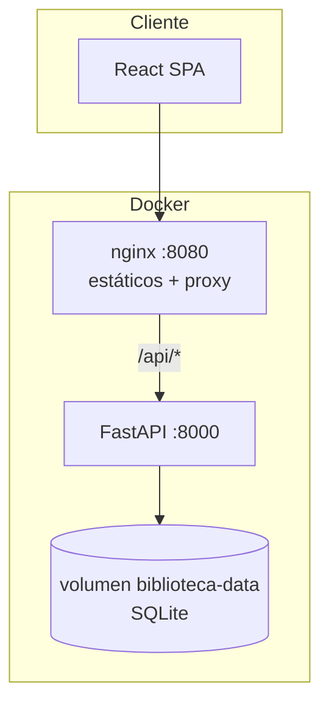
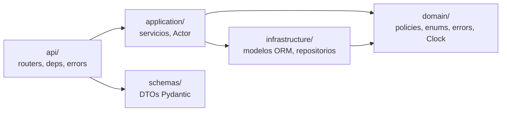
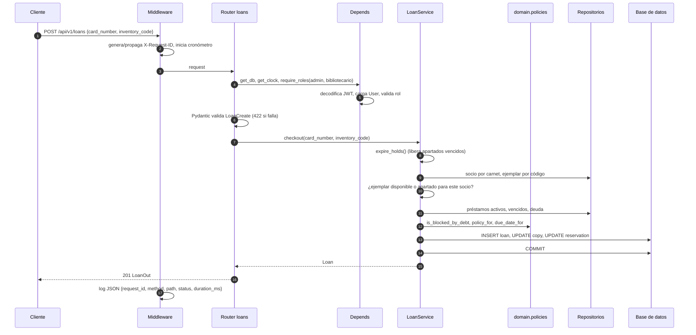

# Arquitectura

## Visión general

El sistema es un monorepo con dos aplicaciones desplegables:

- **backend/**: API REST en FastAPI, organizada en capas.
- **frontend/**: SPA en React servida por nginx, que además hace de proxy de `/api` hacia el backend.

Al usar el mismo origen (nginx sirve la SPA y redirige `/api`), el navegador no necesita CORS en producción. En desarrollo, Vite hace el mismo proxy.

## Capas del backend

| Capa | Responsabilidad | No debe |
|---|---|---|
| `domain` | Reglas puras: políticas por tipo de socio, cálculo de multas, umbral de bloqueo, motivos de rechazo de renovación. Enums y excepciones de negocio. Reloj (`Clock`). | Importar SQLAlchemy, FastAPI ni nada de I/O. |
| `application` | Casos de uso (`LoanService.checkout`, `return_loan`, `renew`, `ReservationService.route_copy`...). Orquesta repositorios, aplica reglas y **controla la transacción** (`commit`). Recibe un `Actor` para decisiones de autorización a nivel de datos. | Conocer HTTP (status codes, headers). |
| `infrastructure` | Engine/sesión, modelos ORM y repositorios con las consultas (filtros, orden, paginación, agregados). | Contener reglas de negocio. |
| `api` | Routers delgados: validan entrada (DTO), resuelven dependencias (`Depends`), exigen rol, llaman al servicio y mapean a DTO de salida. Manejador global de errores. | Contener lógica de negocio. |
| `schemas` | DTOs de entrada (con validación) y salida. | Acceder a la BD. |

### ¿Por qué el ORM no está en `domain`?

Ver [ADR 0001](decisiones/0001-arquitectura-en-capas.md): las entidades se modelan una vez con SQLAlchemy y las reglas de negocio se extraen como funciones puras. Es un compromiso pragmático que mantiene las reglas testeables sin duplicar cada entidad.

## Flujo de una petición: `POST /api/v1/loans`

Si cualquier regla falla, el servicio lanza una excepción de dominio (`BusinessRuleError`, `ConflictError`, `NotFoundError`...). El manejador global la convierte en una respuesta `application/problem+json` con el `status` correspondiente; la sesión se cierra sin `commit`, así que no queda nada a medias.

## Decisiones transversales

- **Reloj inyectable**: `app.state.clock` (por defecto `SystemClock`) se obtiene con `Depends(get_clock)`. En pruebas se pasa un `FixedClock` a `create_app()`. Solo el JWT usa el reloj real, porque PyJWT valida `exp` con la hora del sistema.
- **Fábrica de aplicación**: `create_app(settings, clock, engine)` permite construir instancias aisladas (cada prueba usa su propia BD en memoria).
- **Inyección de servicios**: `provide(LoanService)` crea una dependencia que construye el servicio con sesión, configuración y reloj. Los routers declaran `service: LoanDep`.
- **Autorización en dos niveles**:
  1. Por endpoint, con `StaffDep`/`AdminDep` (`require_roles`).
  2. Por datos, dentro del servicio con `Actor.scope_member_id()` y `Actor.ensure_owns()`: un socio que pide `/loans?member_id=otro` sigue viendo solo lo suyo.
- **Errores**: RFC 7807 con campos extra `code` (estable, para el frontend) y `request_id` (para soporte).
- **Logging**: un JSON por línea; el middleware registra cada petición y los manejadores registran errores de dominio y excepciones no controladas.
- **Fechas y dinero**: fechas en UTC (`UTCDateTime`); vencimientos como `date`; multas en céntimos (`int`) y expuestas como decimal string (`"12.50"`).
- **Expiración de apartados**: se ejecuta de forma perezosa antes de prestar o reservar y también por endpoint, para no depender de un scheduler. Ver [ADR 0002](decisiones/0002-reservas-fifo-y-reloj-inyectable.md).

## Frontend

- `AuthContext` guarda el usuario; el token se persiste en `localStorage` y el cliente API lo envía como `Bearer`. Si el backend responde 401 con un token presente, se cierra la sesión.
- `useFetch` encapsula carga/error/recarga y cancela peticiones obsoletas con `AbortController` (evita condiciones de carrera en buscadores con *debounce*).
- `ProtectedRoute` oculta rutas por rol, pero es solo UX: la autorización real está en el backend.
- Los errores ProblemDetails se transforman en `ApiError` con `fieldErrors`, que los formularios muestran junto a cada campo.
