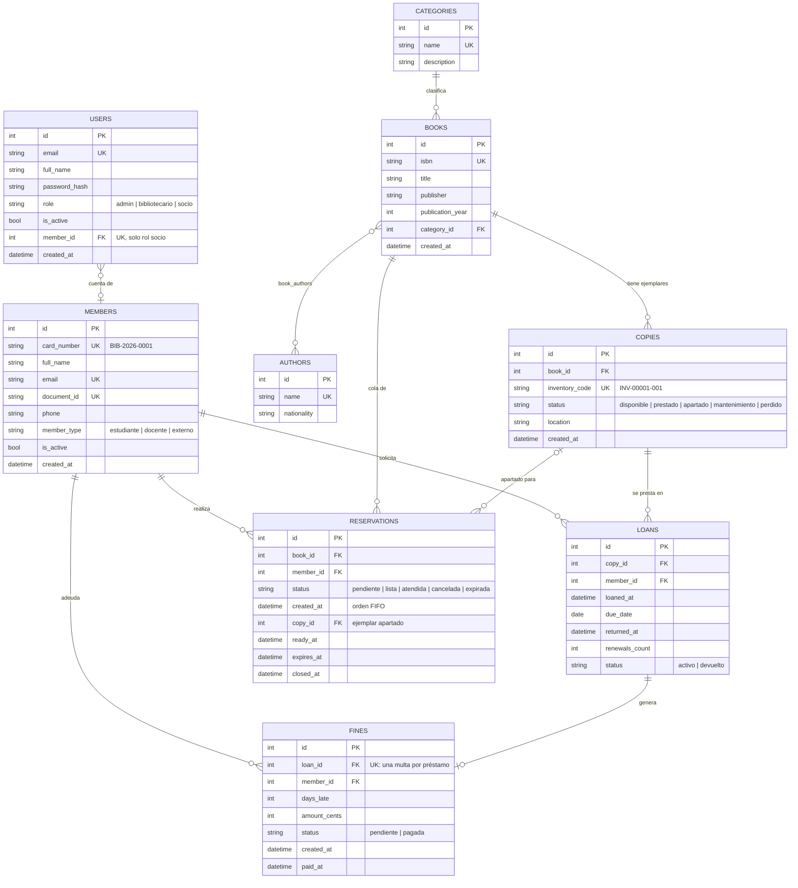
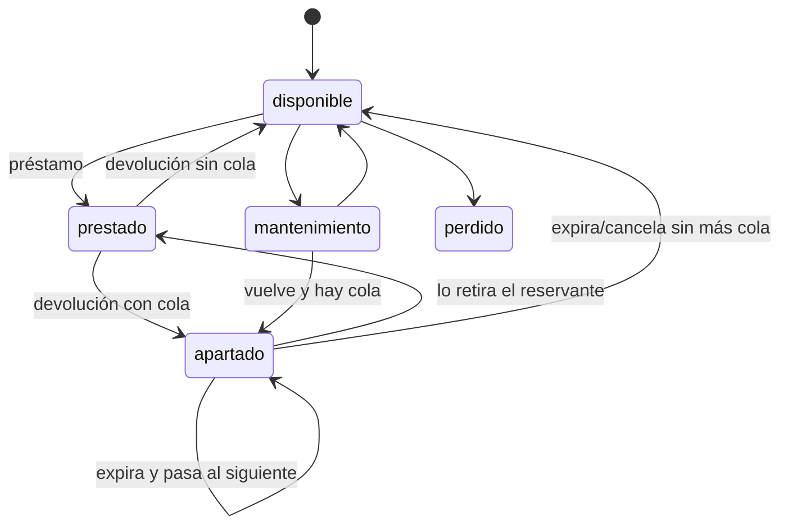

# Modelo de datos

## Tablas

### `users`
Cuentas de acceso. El rol determina qué endpoints puede usar. Un usuario con rol `socio` está vinculado a un registro de `members` (`member_id` único), lo que permite al backend filtrar automáticamente sus datos. Las contraseñas se guardan con **bcrypt**.

### `members`
Socios de la biblioteca. Se separan de `users` porque **no todo socio usa el sistema**: muchos solo se acercan al mostrador. El `card_number` se genera automáticamente (`BIB-<año>-<correlativo>`) y es lo que se escanea al prestar. `member_type` define la política de préstamo.

### `authors`, `categories`, `book_authors`
Catálogos auxiliares. Un libro puede tener varios autores (relación N:M).

### `books`
La **obra** (el título). No se presta directamente: se prestan sus ejemplares. Las reservas se hacen sobre el libro porque al socio le da igual qué ejemplar recibe.

### `copies`
El **objeto físico** con su código de inventario. Su `status` refleja dónde está:

`prestado` y `apartado` solo los asigna el sistema; el personal solo puede poner `disponible`, `mantenimiento` o `perdido`, y no sobre ejemplares en circulación.

### `loans`
Un préstamo de un ejemplar a un socio. `due_date` es una fecha (sin hora): la multa se calcula en días completos. `renewals_count` controla el máximo de renovaciones. El índice `(member_id, status)` acelera las verificaciones de límite.

### `reservations`
Cola FIFO por libro: las pendientes se ordenan por `created_at, id`. Cuando un ejemplar vuelve a circular, la primera pasa a `lista`, recibe `copy_id` y `expires_at`. Estados finales: `atendida` (se convirtió en préstamo), `cancelada`, `expirada`. El índice `(book_id, status, created_at)` sirve directamente a la consulta de la cola.

### `fines`
Multa generada al devolver con retraso. `amount_cents` evita errores de punto flotante. `loan_id` es único: un préstamo genera como máximo una multa. La deuda del socio es la suma de sus multas `pendiente`.

## Convenciones

- **Enums como VARCHAR** (`native_enum=False`): portables y fáciles de migrar si se agregan estados.
- **Fechas en UTC**: el tipo `UTCDateTime` guarda sin zona y devuelve con `tzinfo=UTC`.
- **Claves foráneas activas en SQLite** mediante `PRAGMA foreign_keys=ON` en cada conexión.
- **Unicidad en BD** (ISBN, código de inventario, carnet, correo, DNI) además de la validación en servicios: la BD es la última línea de defensa ante peticiones concurrentes.
